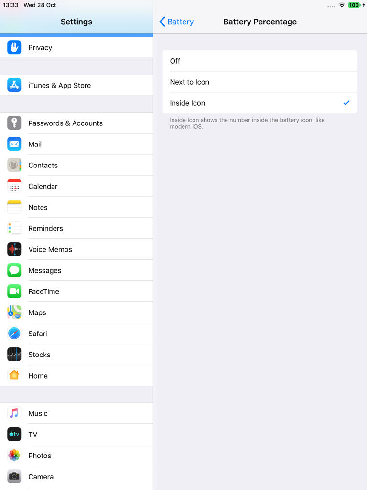
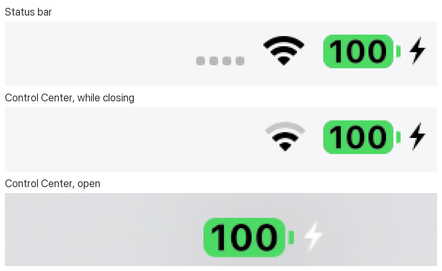

<p align="center"></p>

<h1 align="center">BatteryPlus (iOS 12)</h1>

**The battery features of modern iOS, on iOS 12 iPads.**

On iOS 12, Apple keeps most battery features for iPhone. BatteryPlus brings them to iPad, in the iOS 12 style:

- **Low Power Mode** in Settings > Battery and in Control Center. It is the real iOS mode, not a look-alike.
- **Automatic Low Power Mode** (optional): on when the battery drops to 5, 10, 15 or 20%, off again at 80%.
- **Battery Percentage** next to the battery icon or inside it, like modern iOS.
- **Battery Health:** Maximum Capacity, Cycle Count and Manufacture Date, read from the battery itself.
- **Charging:** an optional Unplug Reminder.

This is an unofficial jailbreak tweak. It is not affiliated with or endorsed by Apple.

## Screenshots

| Settings > Battery | Low Power Mode |
| --- | --- |
|  Battery: Battery Percentage (Inside Icon), Low Power Mode (Automatic), Battery Health and Charging" width="380"> |  |

| Battery Percentage | Battery Health |
| --- | --- |
|  |  |

| Charging | Unplug Reminder |
| --- | --- |
|  |  |

The percentage inside the battery icon, in the status bar and in Control Center (while it closes, Control Center's own status bar takes the status bar's place; the battery matches it pixel for pixel):



Control Center: Low Power Mode off, turned on, and iOS's "Low Power Mode: On" banner (the module needs CCSupport):


## Features

### Low Power Mode

iOS 12 has Low Power Mode on every device, iPad included; only the switch is missing on iPad. BatteryPlus adds a **Low Power Mode** page to Settings > Battery and a **Low Power Mode** module to Control Center.

It turns on the real mode, so the system reacts as it does on iPhone. Verified on an iPad mini 2:

- Apps see it (`NSProcessInfo.lowPowerModeEnabled`), and iOS shows its own "Low Power Mode" alert the first time.
- Dynamic wallpapers and parallax are turned off, and Auto-Lock is limited to 30 seconds.
- Mail stops fetching and iCloud Photos pauses syncing. Background app refresh and automatic downloads follow the same system state.
- The battery icon turns yellow. iOS 12 would also turn the battery percentage on; with BatteryPlus it follows your Battery Percentage setting, which you can still change in Low Power Mode.

On A7 iPads (such as the iPad mini 2) Low Power Mode doesn't slow the CPU. iOS 12 only does that on newer chips. The other savings apply.

**Automatic** (off by default): Low Power Mode turns on when the battery drops to the level you choose (5, 10, 15 or 20%) and turns off again when iPad charges to 80%, with iOS's own "Low Power Mode Turned Off" notification.

- It turns on once per discharge. If you turn it off below the level, it stays off until the battery has been above the level again.
- Turning Automatic on, or choosing a higher level, when the battery is already at or below the level turns Low Power Mode on right away.
- What Automatic turned on is turned off at 80%, even if you turn Automatic off in the meantime.

**Manual:** Low Power Mode that you turn on yourself (in Settings, in Control Center or from iOS's low battery alert) stays on until you turn it off. iOS normally turns it off at 80% whoever turned it on; BatteryPlus keeps it on.

### Battery Percentage

Settings > Battery > Battery Percentage is a page with three choices:

- **Off**.
- **Next to Icon**: iOS 12's "100 %" next to the battery.
- **Inside Icon**: the number inside the battery icon, like modern iOS. The fill shows the charge level in iOS's colours (yellow in Low Power Mode, green while charging, red at 10% or less). In the status bar's own colour the number is cut out of the battery; on yellow, green or red it is drawn in black or white, whichever is easier to read. It works on the Home Screen, the lock screen, in every app (portrait, landscape and Split View) and in Control Center, where it is drawn exactly like the status bar's battery, charging bolt included.

The status bar costs nothing while idle: there are no timers. The battery is only redrawn when iOS updates the status bar or when these settings change.

### Battery Health

All values come straight from the battery's gas gauge. A value that the battery doesn't report is left out instead of guessed.

- **Battery Health:** "Normal" at 80% maximum capacity or more, "Service" below that (Apple's threshold).
- **Maximum Capacity:** full-charge capacity divided by design capacity, the same ratio iOS shows on iPhone.
- **Cycle Count**.
- **Manufacture Date:** decoded from the battery serial number. If the date can't be worked out for certain, the row is hidden.

### Charging

**Unplug Reminder** (off by default): when the iPad charges up to the level you choose (80, 85, 90, 95 or 100%), an alert reminds you to unplug it. You get one reminder per charging session, and only when the level is reached while charging. It's a reminder, not a limit: the iPad keeps charging until you unplug it.

## Compatibility

- Tested on an iPad mini 2 (iPad4,5) with iOS 12.5.8, jailbroken with checkra1n + odysseyra1n (Procursus, libhooker).
- Expected to work on other iOS 12 iPads. Battery data depends on what each battery reports.
- The Control Center module needs [CCSupport](https://github.com/opa334/CCSupport) (recommended by the package). Without it, everything else works and the module is simply not loaded.
- The status bar features cover the iOS 12 iPad status bar. iPhone-only layouts (the notched status bar) aren't changed.
- English only.

## Install

Add the **iOS Legacy** source to your package manager, then search for BatteryPlus:

```
https://itsallexb.github.io/ios-legacy/
```

One tap on your device: [Add to Sileo](https://itsallexb.github.io/ios-legacy/add/sileo.html) · [Add to Zebra](https://itsallexb.github.io/ios-legacy/add/zebra.html) · [Add to Cydia](https://itsallexb.github.io/ios-legacy/add/cydia.html)

Or download the `.deb` from [Releases](https://github.com/itsAllexB/BatteryPlus-iOS12/releases/latest) and install it with Filza or `dpkg -i`, then respring.

Requires `mobilesubstrate` (Substrate, Substitute or libhooker) and PreferenceLoader. Your package manager installs them automatically. Install CCSupport too for the Control Center module.

## Settings

Everything is in **Settings > Battery**:

- **Battery Percentage**: Off, Next to Icon or Inside Icon.
- **Low Power Mode**:
  - Automatic: **Turn On Automatically** (off by default) and **Turn On At** (5%, 10%, 15% or 20%).
  - Manual: the **Low Power Mode** switch.
- **Battery Health**: Maximum Capacity, Cycle Count and Manufacture Date.
- **Charging**: **Unplug Reminder** (off by default) and **Remind At** (80%, 85%, 90%, 95% or 100%).

To add Low Power Mode to Control Center, open **Settings > Control Center > Customize Controls** (needs CCSupport).

## Known limits

- No charge limit and no optimized charging. A7 iPads can't pause charging while power is connected: the charger ignores the request that charge-limit tools use for this on newer devices, and there is no safe way to do it on this hardware, so BatteryPlus doesn't change how the iPad charges.
- Keeping manual Low Power Mode on past 80% works by setting iOS's own turn-off level out of reach while BatteryPlus runs. After a reboot, until the jailbreak runs again, that setting stays, and nothing turns Low Power Mode off at 80%. Removing BatteryPlus restores iOS's 80%.
- Maximum Capacity is what the gas gauge reports. After a long time unused, or right after a battery replacement, the gauge can be off until it has seen a few full charge cycles.
- Batteries before iPhone 15 don't store a first-use date, so there is no First Use row.
- iOS 12 also shows the battery percentage on the lock screen while iPad is charging. BatteryPlus leaves that as it is.

## Build from source

You need [Theos](https://theos.dev/docs/installation) and an iOS SDK (the Makefile uses the iOS 14.5 SDK and targets iOS 12.0, arm64).

```sh
git clone https://github.com/itsAllexB/BatteryPlus-iOS12.git
cd BatteryPlus-iOS12
make package FINALPACKAGE=1
```

The package is written to `packages/`. To install it on a device over SSH, set `THEOS_DEVICE_IP` and run `make install`.

What's in this repo:

- `Tweak.x`, `BPControllers.m`, `BPBattery.m`: the Settings > Battery additions (loaded into Settings only). Low Power Mode is available because Settings is told, inside Settings only, that the device supports it (`+[PLModelingUtilities isLowPowerModeSupported]`). Everything behind the switch is Apple's: CoreDuet's battery saver turns the mode on and the system reacts to it. Battery data is read from IOKit (`IOPMPowerSource`).
- `StatusBar.x`: the status bar battery (`UIStatusBarBatteryItemView`), loaded into every app because each app draws its own status bar, and Control Center's battery (`_UIBatteryView`). The settings reach sandboxed apps through a notify state (`com.itsallexb.batteryplus.statusbar`).
- `ccmodule/`: the Control Center module (for CCSupport). It uses iOS's own battery glyph from the system Low Power Mode module.
- `daemon/`: `batteryplusd`, a small daemon that runs as `mobile`: the Unplug Reminder and Automatic Low Power Mode. It reads the battery state when iOS posts a power-source notification and never writes anything to the hardware.

The comments at the top of each file explain the details, including how the manufacture date is decoded.

## Credits and license

Made by [itsAllexB](https://github.com/itsAllexB).

- [ChargeLimiter](https://github.com/lich4/ChargeLimiter) by lich4 (GPL-3.0) was the reference for which IOKit properties charge-control tools use on iOS 12. BatteryPlus doesn't contain its code.
- [CCSupport](https://github.com/opa334/CCSupport) by opa334 loads the Control Center module.
- PoomSmart's BatteryHealthEnabler turns on the iPhone-only native Battery Health page on iPad. It shows Maximum Capacity only.

BatteryPlus is free software under the GNU General Public License v3.0 or later. See [LICENSE](LICENSE).

iPad, iPhone and Low Power Mode are trademarks of Apple Inc. This project is not affiliated with Apple.
