<p align="center">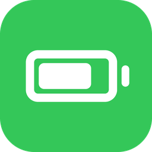</p>

<h1 align="center">BatteryPlus (iOS 12)</h1>

**The battery features of modern iOS, on iOS 12 iPads.**

On iOS 12, Apple keeps most battery features for iPhone. BatteryPlus brings them to iPad, in the iOS 12 style:

- **Low Power Mode** in Settings > Battery and in Control Center. It is the real iOS mode, not a look-alike.
- **Battery Health:** Maximum Capacity, Cycle Count and Manufacture Date, read from the battery itself.
- **Charging:** an optional Unplug Reminder.
- **Battery colours**, like modern iOS: the battery turns yellow in Low Power Mode, green while charging and red at 20% or less.
- **Percentage inside the battery icon**, like modern iOS (optional).

This is an unofficial jailbreak tweak. It is not affiliated with or endorsed by Apple.

## Screenshots

| Settings > Battery | Low Power Mode on |
| --- | --- |
| 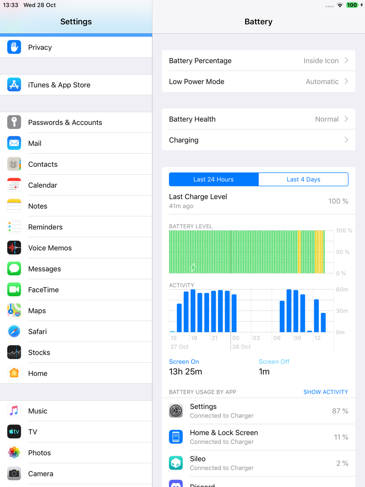 Battery" width="380"> | 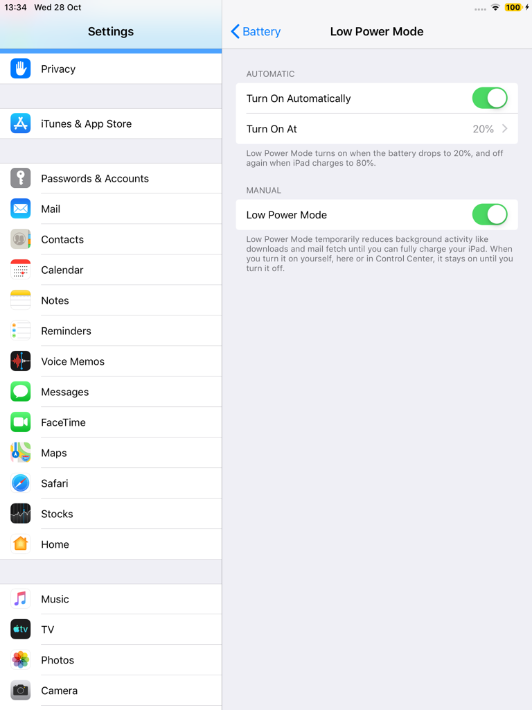 |

| Battery Health | Charging |
| --- | --- |
| 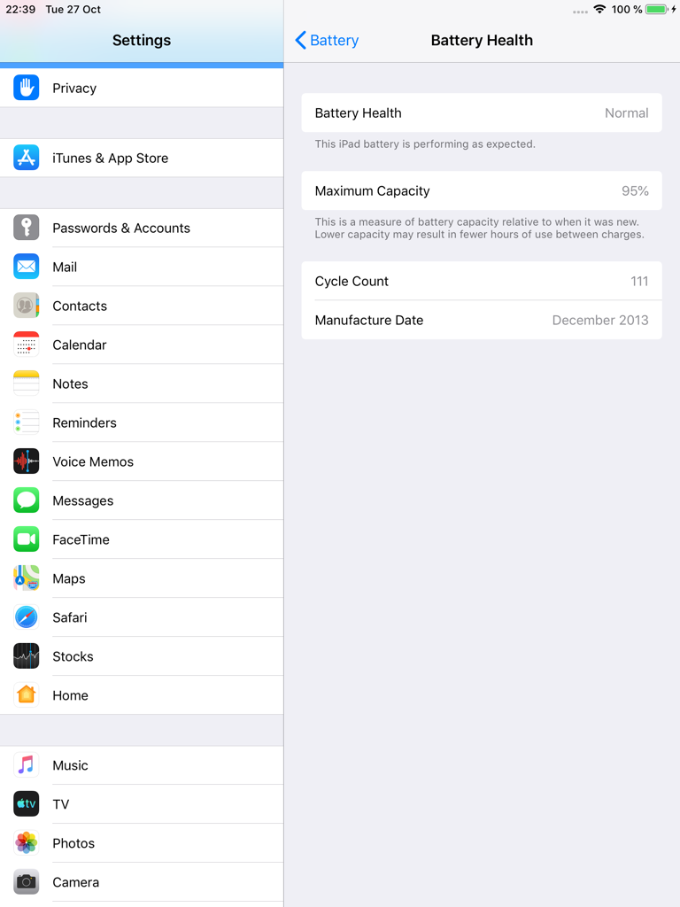 | 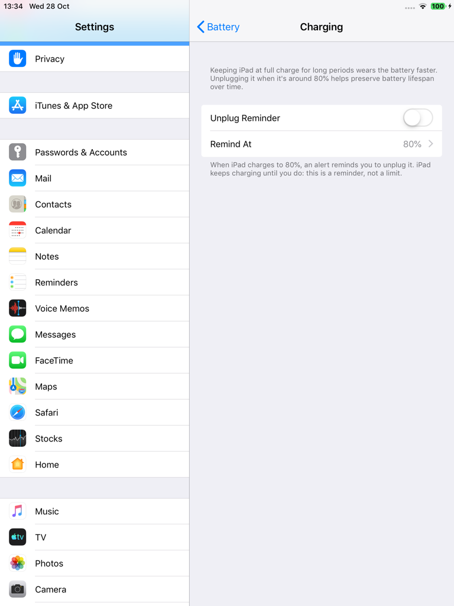 |

The Unplug Reminder, and Settings > Battery > Status Bar:

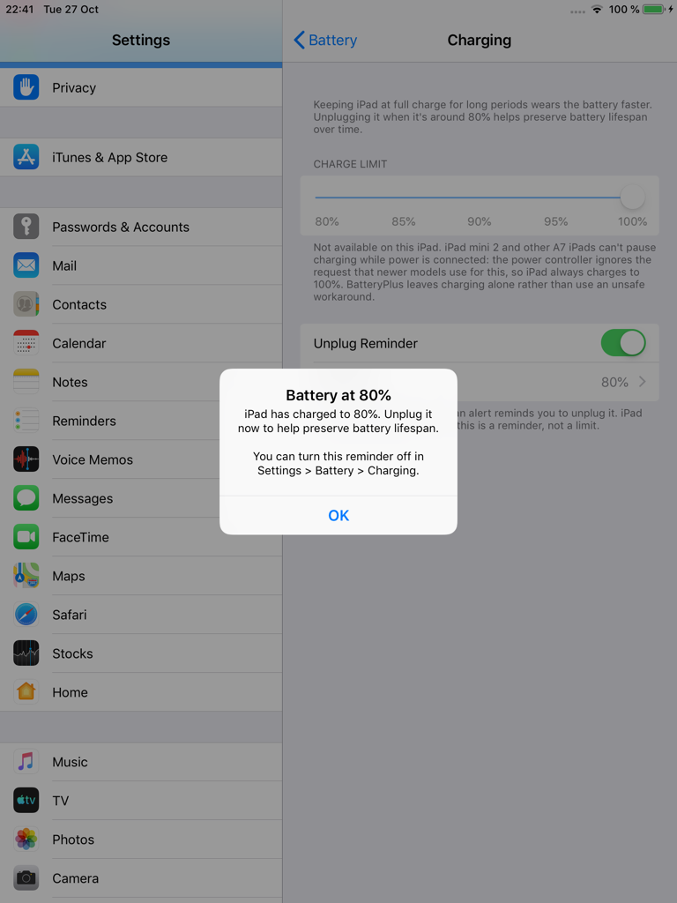 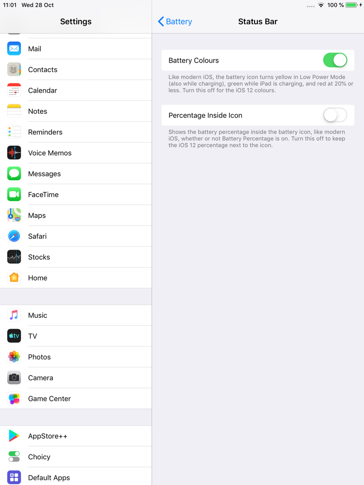

Control Center: Low Power Mode off, turned on, and iOS's "Low Power Mode: On" banner (the module needs CCSupport):

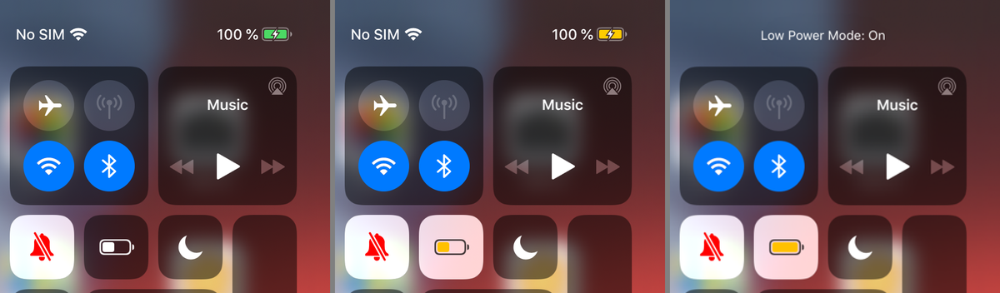

Battery colours in the status bar, compared with iOS 12. They differ at 11 to 20% (red instead of white) and when charging at 10% or less (green instead of red):

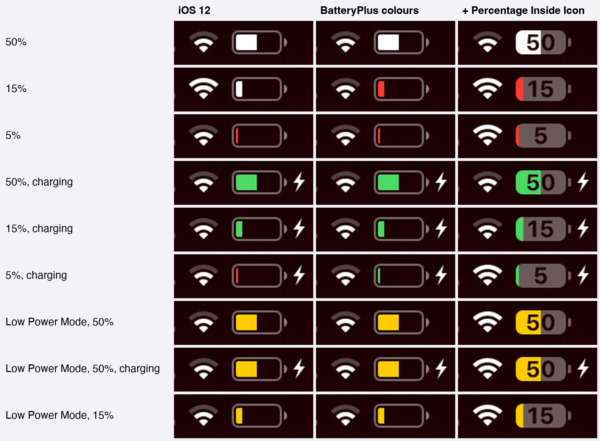

Percentage inside the icon (optional), and in apps, in landscape and in Split View:

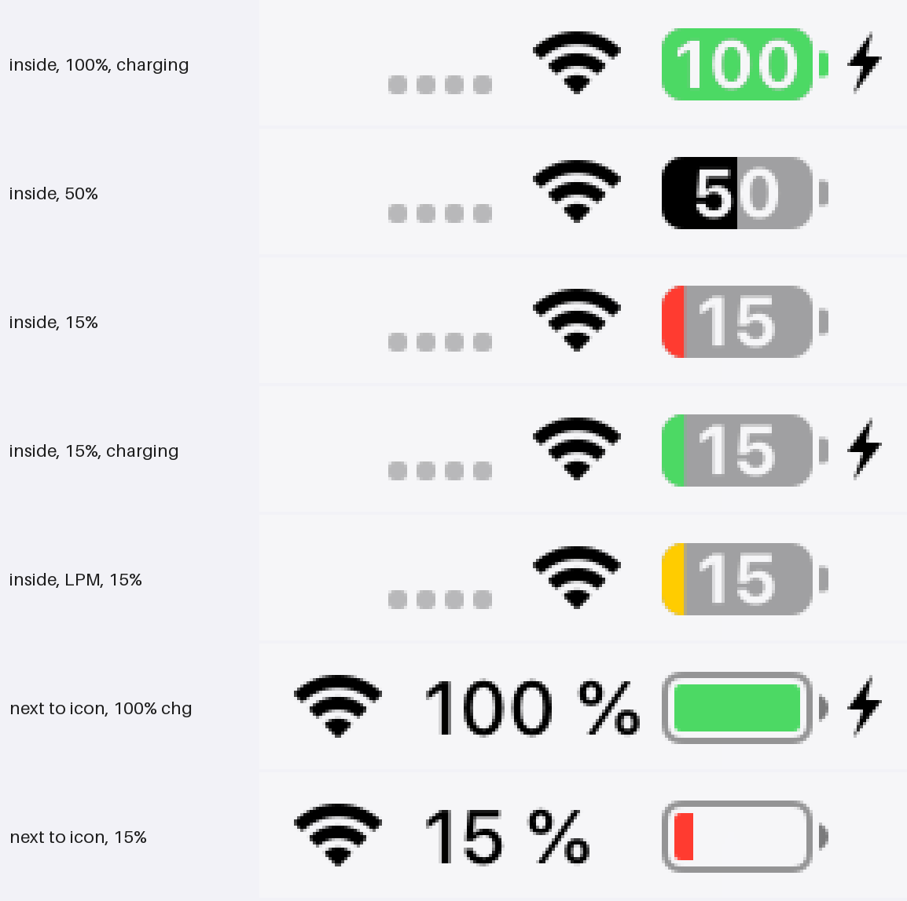

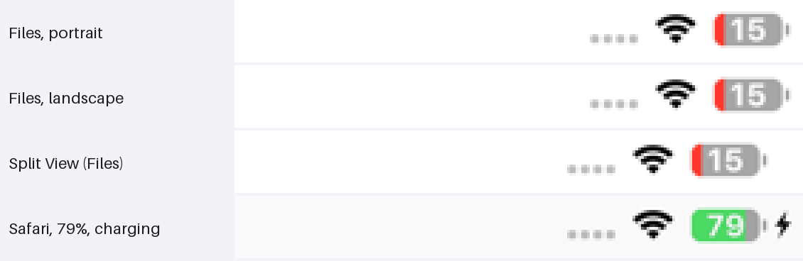

## Features

### Low Power Mode

iOS 12 has Low Power Mode on every device, iPad included; only the switch is missing on iPad. BatteryPlus shows Apple's own switch at the top of Settings > Battery, as on iPhone, and adds a **Low Power Mode** module to Control Center.

It turns on the real mode, so the system reacts as it does on iPhone. Verified on an iPad mini 2:

- Apps see it (`NSProcessInfo.lowPowerModeEnabled`), and iOS shows its own "Low Power Mode" alert the first time.
- Dynamic wallpapers and parallax are turned off, and Auto-Lock is limited to 30 seconds.
- Mail stops fetching and iCloud Photos pauses syncing. Background app refresh and automatic downloads follow the same system state.
- The battery icon turns yellow. iOS 12 would also turn the battery percentage on; with BatteryPlus it follows the Battery Percentage switch, so you can keep it off.
- iOS turns the mode off by itself when the battery charges back to 80%, as on iPhone.

On A7 iPads (such as the iPad mini 2) Low Power Mode doesn't slow the CPU. iOS 12 only does that on newer chips. The other savings apply.

### Battery Health

All values come straight from the battery's gas gauge. A value that the battery doesn't report is left out instead of guessed.

- **Battery Health:** "Normal" at 80% maximum capacity or more, "Service" below that (Apple's threshold).
- **Maximum Capacity:** full-charge capacity divided by design capacity, the same ratio iOS shows on iPhone.
- **Cycle Count**.
- **Manufacture Date:** decoded from the battery serial number. If the date can't be worked out for certain, the row is hidden.

### Charging

- **Charge Limit** is shown but unavailable, with the reason. A7 iPads can't pause charging while power is connected: the charger ignores the request that charge-limit tools use for this on newer devices. Since there is no safe way to do it on this hardware, BatteryPlus doesn't change how the iPad charges. Optimized Battery Charging needs the same pause, so it isn't offered either.
- **Unplug Reminder** (off by default): when the iPad charges up to the level you choose (80, 85, 90, 95 or 100%), an alert reminds you to unplug it. You get one reminder per charging session, and only when the level is reached while charging. It's a reminder, not a limit: the iPad keeps charging until you unplug it.

### Status bar

- **Battery Colours** (on by default), with the rules of modern iOS:

  | State | Colour |
  | --- | --- |
  | Low Power Mode | yellow, also while charging |
  | Charging | green, at any level |
  | 20% or less, not charging | red |
  | Otherwise | the status bar colour (white or black) |

  With it off, iOS 12's own rules apply.
- **Percentage Inside Icon** (off by default): the number is drawn inside the battery icon instead of next to it, like modern iOS, whether or not Battery Percentage is on. It reads at every level, on light and dark status bars.
- Works on the Home Screen, the lock screen, in Control Center and in every app, in portrait, landscape and Split View.
- It costs nothing while idle: there are no timers. The battery is only redrawn when iOS updates the status bar or when Low Power Mode or these settings change.

## Compatibility

- Tested on an iPad mini 2 (iPad4,5) with iOS 12.5.8, jailbroken with checkra1n + odysseyra1n (Procursus, libhooker).
- Expected to work on other iOS 12 iPads. Battery data depends on what each battery reports.
- The Control Center module needs [CCSupport](https://github.com/opa334/CCSupport) (recommended by the package). Without it, everything else works and the module is simply not loaded.
- The status bar features cover the iOS 12 iPad status bar. iPhone-only layouts (the notched status bar) aren't changed.
- English only.

## Install

Add the **iOS Legacy** source to your package manager, then search for BatteryPlus:

```
https://itsallexb.github.io/ios-legacy/
```

One tap on your device: [Add to Sileo](https://itsallexb.github.io/ios-legacy/add/sileo.html) · [Add to Zebra](https://itsallexb.github.io/ios-legacy/add/zebra.html) · [Add to Cydia](https://itsallexb.github.io/ios-legacy/add/cydia.html)

Or download the `.deb` from [Releases](https://github.com/itsAllexB/BatteryPlus-iOS12/releases/latest) and install it with Filza or `dpkg -i`, then respring.

Requires `mobilesubstrate` (Substrate, Substitute or libhooker) and PreferenceLoader. Your package manager installs them automatically. Install CCSupport too for the Control Center module.

## Settings

Everything is in **Settings > Battery**:

- **Low Power Mode**: Apple's switch, at the top of the page.
- **Battery Health**: Maximum Capacity, Cycle Count and Manufacture Date.
- **Charging**:
  - **Charge Limit**: shown as unavailable on A7 iPads, with the reason.
  - **Unplug Reminder** (off by default) and **Remind At** (80%, 85%, 90%, 95% or 100%).
- **Status Bar**:
  - **Battery Colours** (on by default).
  - **Percentage Inside Icon** (off by default). Works with Battery Percentage on or off.

To add Low Power Mode to Control Center, open **Settings > Control Center > Customize Controls** (needs CCSupport).

## Known limits

- No charge limit and no optimized charging on A7 iPads (see [Charging](#charging)).
- The automatic turn-off at 80% is iOS's own. It was checked in the system, not by charging a drained battery.
- Maximum Capacity is what the gas gauge reports. After a long time unused, or right after a battery replacement, the gauge can be off until it has seen a few full charge cycles.
- Batteries before iPhone 15 don't store a first-use date, so there is no First Use row.
- With Percentage Inside Icon on, Control Center's status bar shows charging only by the green fill. Unlike the main status bar, it has no separate bolt next to the battery on iPad.
- iOS 12 also shows the battery percentage on the lock screen while iPad is charging. BatteryPlus leaves that as it is.

## Build from source

You need [Theos](https://theos.dev/docs/installation) and an iOS SDK (the Makefile uses the iOS 14.5 SDK and targets iOS 12.0, arm64).

```sh
git clone https://github.com/itsAllexB/BatteryPlus-iOS12.git
cd BatteryPlus-iOS12
make package FINALPACKAGE=1
```

The package is written to `packages/`. To install it on a device over SSH, set `THEOS_DEVICE_IP` and run `make install`.

What's in this repo:

- `Tweak.x`, `BPControllers.m`, `BPBattery.m`: the Settings > Battery additions (loaded into Settings only). The Low Power Mode switch appears because Settings is told, inside Settings only, that the device supports it (`+[PLModelingUtilities isLowPowerModeSupported]`). Everything behind the switch is Apple's: CoreDuet's battery saver turns the mode on and the system reacts to it. Battery data is read from IOKit (`IOPMPowerSource`).
- `StatusBar.x`: the status bar battery (`UIStatusBarBatteryItemView`), loaded into every app because each app draws its own status bar. The settings reach sandboxed apps through a notify state (`com.itsallexb.batteryplus.statusbar`).
- `ccmodule/`: the Control Center module (for CCSupport). It uses iOS's own battery glyph from the system Low Power Mode module.
- `daemon/`: `batteryplusd`, a small daemon that runs as `mobile` and shows the Unplug Reminder. It only reads the battery state when iOS posts a power-source notification, and never writes anything to the hardware.

The comments at the top of each file explain the details, including how the manufacture date is decoded.

## Credits and license

Made by [itsAllexB](https://github.com/itsAllexB).

- [ChargeLimiter](https://github.com/lich4/ChargeLimiter) by lich4 (GPL-3.0) was the reference for which IOKit properties charge-control tools use on iOS 12. BatteryPlus doesn't contain its code.
- [CCSupport](https://github.com/opa334/CCSupport) by opa334 loads the Control Center module.
- PoomSmart's BatteryHealthEnabler turns on the iPhone-only native Battery Health page on iPad. It shows Maximum Capacity only.

BatteryPlus is free software under the GNU General Public License v3.0 or later. See [LICENSE](LICENSE).

iPad, iPhone and Low Power Mode are trademarks of Apple Inc. This project is not affiliated with Apple.
